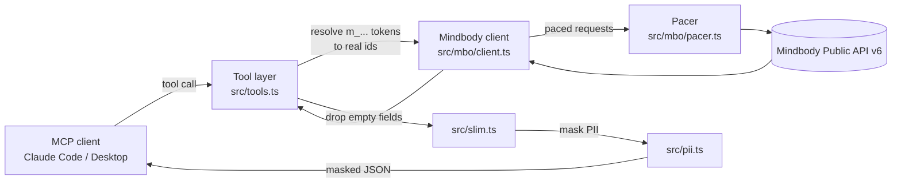

# mindbody-mcp-server

An unofficial [Model Context Protocol](https://modelcontextprotocol.io) (MCP) server for the
Mindbody Public API v6. It lets an MCP client such as Claude Code or Claude Desktop answer
questions about a Mindbody site — schedules, attendance, sales, services, contracts — without
handing the model your members' personal details.

This project is not affiliated with, endorsed by, or supported by Mindbody. "Mindbody" is a
trademark of its owner. You need your own Mindbody developer account and API key.

## The problem

Mindbody data is mostly about people. A raw API response for one client includes their email,
phone numbers, home address, birth date, staff alerts and custom fields, which is where staff
often write medical or safeguarding notes. If you connect a model straight to the API, all of
that goes into the model's context. Most questions you want to ask ("how many sessions did this
member attend last month?", "which intro offers sold this week?") do not need any of it.

## How it works



1. The client calls a tool. If the arguments contain member tokens (`m_...`) from an earlier
   result, the server swaps them for the real Mindbody ids. Only the outbound API request sees
   the real id.
2. The request goes through a pacer that spaces calls to each site, then to Mindbody with retry
   and backoff.
3. The response has empty fields removed, then passes through the PII mask, then goes back to
   the client as compact JSON.

## Tools

Read-only, always available:

| Tool | What it returns |
| --- | --- |
| `mbo_search_clients` | Members matching a name, email or phone search, or specific client ids |
| `mbo_get_client` | One client's profile, services, contracts and balances |
| `mbo_get_client_services` | A client's purchased services, with remaining counts and expiry |
| `mbo_get_client_contracts` | A client's contracts and autopay status |
| `mbo_classify_client_payment` | A derived verdict: paying, past due, on hold, promo, comp or none |
| `mbo_get_client_visits` | A client's visit history in a date range |
| `mbo_get_classes` | The class schedule for a date range, with booked and signed-in counts |
| `mbo_get_class_visits` | Rosters for specific classes |
| `mbo_get_staff` | Staff at a site |
| `mbo_get_sales` | Sales in a date range |
| `mbo_get_services` | The site's price list (cached for 12 hours) |
| `mbo_get_site_info` | Sites, locations, programs, session types, memberships or resources |
| `mbo_api_get` | Any other v6 GET endpoint, with optional pagination |

Writes, only when `MBO_ALLOW_WRITES=true`:

| Tool | What it does |
| --- | --- |
| `mbo_add_contact_log` | Adds a contact-log entry to a client |
| `mbo_update_client` | Updates profile fields on a client |

Webhook admin, only when `MBO_ALLOW_WEBHOOK_ADMIN=true`:

| Tool | What it does |
| --- | --- |
| `mbo_list_webhook_subscriptions` | Lists webhook subscriptions |
| `mbo_create_webhook_subscription` | Creates a subscription |
| `mbo_delete_webhook_subscription` | Deletes a subscription |

## Safety design

- **Read-only by default.** With no flags set, the server registers only read tools. Write and
  webhook tools are not registered at all, so the model cannot see or call them.
- **PII masking before anything reaches the model.** Every tool result passes through
  `src/pii.ts`:
  - Contact details (email, phones, address, city, postal code, birth date), notes, alerts,
    custom fields, contract text, photos and card or barcode fields are removed.
  - Member ids are replaced with stable pseudonyms (`m_` plus 16 hex characters, an HMAC with a
    random key created when the server starts).
  - Member names become initials.
  - On a person record, any other text field is withheld unless it is on a short allowlist
    (status, membership name, service name and similar) or is a date. The names of withheld
    fields are listed in `_withheld` so the model knows they exist.
  - Counts, totals, prices, dates and service names pass through unchanged.
- **Writes behind explicit flags.** `MBO_ALLOW_WRITES` and `MBO_ALLOW_WEBHOOK_ADMIN` must be set
  to `true`, `1` or `yes`. Anything else leaves them off.
- **Rate-limit pacing.** The pacer keeps a minimum gap between calls to the same site, widens
  that gap if one site gets a sustained burst of calls, pauses a site after Mindbody returns a
  429 that survives the client's own retries, and caps how many calls run at once. If a call
  would wait too long, it fails with a clear "busy" error instead of hanging. The client also
  retries 429 and 5xx responses with exponential backoff and honors `Retry-After`.
- **Errors do not echo requests.** Error messages include the path, status and
  Mindbody's own error code and message, never request headers or bodies.

## What it does not do

- It does not expose contact logs for reading. Their content is free text written by staff,
  which a field-based mask cannot make safe.
- It does not store anything. There is no database or cache on disk; the token-to-id map and the
  price-list cache live in memory and are gone when the process exits.
- It does not run as a hosted, multi-user service. It is a local stdio server for one user.
- It does not send anything to members.

## Setup

You need Node.js 18 or later.

1. Create a developer account at [developers.mindbodyonline.com](https://developers.mindbodyonline.com)
   and get an API key.
2. Use Mindbody's public sandbox site, SiteId `-99`, while you try it out. The sandbox staff
   login is in the Mindbody developer documentation.
3. Build the server:

   ```sh
   git clone <this repo>
   cd mindbody-mcp-server
   npm install
   npm run build
   ```

### Claude Code

```sh
claude mcp add mindbody \
  -e MBO_API_KEY=your-api-key \
  -e MBO_USERNAME=your-staff-username \
  -e MBO_PASSWORD=your-staff-password \
  -e MBO_SITE_ID=-99 \
  -- node /absolute/path/to/mindbody-mcp-server/dist/index.js
```

### Claude Desktop

Add this to `claude_desktop_config.json`:

```json
{
  "mcpServers": {
    "mindbody": {
      "command": "node",
      "args": ["/absolute/path/to/mindbody-mcp-server/dist/index.js"],
      "env": {
        "MBO_API_KEY": "your-api-key",
        "MBO_USERNAME": "your-staff-username",
        "MBO_PASSWORD": "your-staff-password",
        "MBO_SITE_ID": "-99"
      }
    }
  }
}
```

## Configuration

| Variable | Required | Default | Meaning |
| --- | --- | --- | --- |
| `MBO_API_KEY` | yes | | Your Mindbody API key |
| `MBO_USERNAME` | yes | | Staff username for the site |
| `MBO_PASSWORD` | yes | | Staff password for the site |
| `MBO_SITE_ID` | no | none | Default SiteId when a tool call does not pass one |
| `MBO_ALLOW_WRITES` | no | off | Registers the write tools |
| `MBO_ALLOW_WEBHOOK_ADMIN` | no | off | Registers the webhook admin tools |
| `MBO_API_BASE` | no | `https://api.mindbodyonline.com/public/v6` | API base URL |
| `MBO_WEBHOOKS_BASE` | no | `https://mindbody.io/platform/webhooks/v1` | Webhooks API base URL |
| `MBO_MCP_PROGRESS` | no | on | Set to `off` to stop progress notifications |

`.env.example` lists the same variables. Do not commit real values.

## Development

```sh
npm test
```

This builds the TypeScript and runs the tests in `tests/` with Node's built-in test runner. The
tests use fake HTTP responses and synthetic data; they make no network calls.

## Limitations

- Member tokens are valid only for the server process that issued them. After a restart, search
  for the member again.
- Staff records from `/staff/staff` look like person records to the mask, so staff names are
  reduced to initials and staff ids are pseudonymized there too. Fields named for staff, such as
  `StaffName` or `CoachName`, and records that carry a `StaffId`, keep the full name.
- The mask works on field names and value types. It is conservative, and it is tested against
  the Mindbody response shapes I know about, but a new Mindbody field with an unexpected name
  could still carry personal data. Review results before sharing them.
- `mbo_api_get` reaches any GET endpoint. Its results are masked like every other tool, but the
  mask has only been checked against the common endpoints.
- The pacer's gaps are conservative defaults, not Mindbody's published limits. Mindbody does not
  publish a per-second limit.

## Status

This is a cleaned-up, standalone version of an MCP server I built for a private project. This
public version has been tested only with the unit and smoke tests in this repo, using synthetic
data. It has not yet been run against the Mindbody sandbox in this form.

## License

MIT. See [LICENSE](LICENSE).
